<h3>I build backends that hold up under real traffic and real money, and I ship them faster with AI in the loop.</h3>

<b>Remote · Pakistan (UTC+5)</b> · Open to contract and full-time work · Overlaps with US and EU hours

## About

I build the backend systems that keep products fast, reliable and correct with their data: APIs, queues, caches, data pipelines and the AWS infrastructure underneath. I work across the stack, so I also ship the React and Next.js front ends that sit on top of those services.

Five years in, I have worked with seven teams across product companies and agencies, delivered for clients in the US, Germany and Turkey, and led a team of four engineers on a real-time stats platform. Most of my recent work is data-heavy and payments-heavy, where correctness matters more than speed of delivery.

Right now I am freelancing full time, building a recurring donations and payments platform for a direct client.

**On confidentiality:** most of my client work lives in private repositories under NDA, and I keep those agreements after a project ships, after a contract closes, and after the work ends on my side. That is why some projects below are described without the client or product name, and why most of my GitHub activity is private.

## What I do

<table>
<tr>
<td width="50%" valign="top">
<h4>Backend and APIs</h4>
Fast, typed APIs your apps and partners can rely on. REST and GraphQL in Node.js and TypeScript, validated with Zod, documented with Swagger.
</td>
<td width="50%" valign="top">
<h4>Cloud and serverless</h4>
Infrastructure that scales up for busy days and costs less on quiet ones. AWS Lambda, ECS Fargate, SQS and S3, monoliths moved to microservices, Terraform for everything.
</td>
</tr>
<tr>
<td width="50%" valign="top">
<h4>Data, queues and caching</h4>
Millions of records moved, and pages that stay instant. Redis queues and caches, Kinesis streams, worker pools with backpressure.
</td>
<td width="50%" valign="top">
<h4>Full-stack and team lead</h4>
From the first client call to a shipped product. Next.js front ends, estimates, sprint planning, code review and leading delivery teams.
</td>
</tr>
</table>

## Featured work

<table>
<tr>
<th width="22%" align="left">Project</th>
<th width="26%" align="left">The problem</th>
<th width="30%" align="left">What I did</th>
<th width="22%" align="left">What changed</th>
</tr>
<tr>
<td valign="top"><b>Safety Compliance Platform</b> Enterprise · AWS serverless Client and product name withheld</td>
<td valign="top">Company hierarchies 20 to 30 levels deep took 3 to 4 minutes to assemble in Lambda and often timed out. The database could not be changed.</td>
<td valign="top">Precomputed the hierarchy as JSON in S3, rebuilt by a sync Lambda on every change through SQS. Moved monolithic APIs to serverless microservices with Terraform.</td>
<td valign="top">No recursion on the read path and the timeouts are gone. Infrastructure cost down by around <b>30%</b>.</td>
</tr>
<tr>
<td valign="top"><b>Recurring Donations Platform</b> Payments · live migration Client and product name withheld</td>
<td valign="top">A live recurring-payments platform had to move to a new Postgres backend and auth provider, with a daily charge run that could never be missed.</td>
<td valign="top">Wrote and rehearsed the migration on staging first. Built scheduled recurring transactions with retry, idempotency and reconciliation on Supabase, Deno edge functions and Next.js.</td>
<td valign="top"><b>0</b> downtime, <b>0</b> records lost, <b>0</b> missed charge runs.</td>
</tr>
<tr>
<td valign="top"><b>PlayerTotals</b> Sports data · public product Team of 4</td>
<td valign="top">Near-real-time NBA, NFL and MLB stats on top of external APIs with hard rate limits.</td>
<td valign="top">Cron ingestion every 5 minutes into versioned MongoDB history, with a bounded Redis hot window in front. Led the team of four engineers.</td>
<td valign="top">Stats refresh <b>every 5 minutes</b> within the provider's rate limits, and history survives even if the provider drops it.</td>
</tr>
</table>

### All projects

| Project | What it is | Built with |
| --- | --- | --- |
| **Retail Price-Auditing Backend**  Data pipeline · Retail | Backend for a mobile-first price auditing product used by a US retailer, designed from scratch. Over 2 million records per run pulled from an external feed, queued through Redis and written in parallel by Node.js worker threads, then served back paginated and queryable. | Node.js, Express, TypeScript, TypeORM, Redis, AWS ECS Fargate, Terraform, Datadog, Okta |
| **Recurring Donations Platform**  Payments · Non-profit | Recurring donations and payments platform for a direct client, with scheduled recurring transactions, authentication, storage and edge functions. Client and product name withheld. | Next.js, TypeScript, Supabase, Deno, PostgreSQL |
| **PlayerTotals**  Real-time · Sports | Live sports statistics platform covering NBA, NFL and MLB, fetched on a 5-minute cycle with Redis queues and MongoDB for high-throughput processing. | Node.js, TypeScript, React, MongoDB, Redis |
| **Memberstore**  Commerce · Payments | One storefront serving multiple independent merchants, each selling under their own brand. Stripe handles payments, merchant onboarding and webhook reconciliation. | KeystoneJS, GraphQL, MongoDB, Next.js, TypeScript, Stripe |
| **CivaSource**  AI matching · Marketplace | AI-assisted product matching for a supply marketplace. Extracts up to 1,000 products per minute using asyncio with Redis caching, behind a FastAPI service with authentication. | Python, FastAPI, Redis, PostgreSQL |
| **Safety Compliance Platform**  Compliance · Enterprise | Safety checklists and compliance workflows across multiple industrial sites, with a multi-site audit trail. Client and product name withheld. | Node.js, TypeScript, AWS Lambda, SQS, Kinesis, S3, PostgreSQL, Terraform |
| **Real Time Gaming Platform**  Real-time · Gaming | JavaScript bot libraries and WebSocket connections for in-game bot behavior, plus the UI and command libraries used to control them. Client and product name withheld. | JavaScript, Node.js, WebSocket |
| **[TradeFundrr](https://tradefundrr.com)**  EdTech · CRM | Trading education platform with an integrated CRM used by its own sales team. | Python, Flask, Django, React, PostgreSQL |
| **Al Khair Traders POS**  Business app · Wholesale | Replaced a paper process for a wholesale trader: products, suppliers, purchases, sales, returns and quotations in one system, with role-based permissions down to the module level. | Node.js, Express, React, TypeScript, TypeORM, TanStack Query, MySQL, JWT |
| **[AutoTempest](https://www.autotempest.com)**  Search · Automotive | Car search across many listing sites at once, filtered in a single form. Built the responsive React front end and the REST API over scraped listings. | React, Node.js, MySQL, REST APIs, Web Scraping |
| **Points App**  Loyalty · Payments | Customer loyalty scheme where points convert into mobile top-up codes, including the redemption flow and payment processing. | Node.js, React, MySQL |
| **N1QL-to-Firebase Automation Tool**  Developer tool · Final year project | Converts Couchbase N1QL queries into Firebase Cloud Functions and deploys them, removing the hand translation step. | Node.js, Firebase, Couchbase, N1QL, JavaScript |

## Tech stack

<table>
<tr>
<td valign="top" width="170"><b>Languages</b></td>
<td>

</td>
</tr>
<tr>
<td valign="top" width="170"><b>Backend and APIs</b></td>
<td>

</td>
</tr>
<tr>
<td valign="top" width="170"><b>Frontend</b></td>
<td>

</td>
</tr>
<tr>
<td valign="top" width="170"><b>Databases and caching</b></td>
<td>

</td>
</tr>
<tr>
<td valign="top" width="170"><b>AWS</b></td>
<td>

</td>
</tr>
<tr>
<td valign="top" width="170"><b>DevOps and observability</b></td>
<td>

</td>
</tr>
<tr>
<td valign="top" width="170"><b>Platforms, payments and auth</b></td>
<td>

</td>
</tr>
<tr>
<td valign="top" width="170"><b>AI tools I use daily</b></td>
<td>

</td>
</tr>
<tr>
<td valign="top" width="170"><b>Tools and collaboration</b></td>
<td>

</td>
</tr>
</table>

**Strongest in:** Node.js, TypeScript, Express, PostgreSQL, MongoDB, Redis, Next.js and React, which I have built with every day since 2021.

## Experience

| Role | Company | Period | Focus |
| --- | --- | --- | --- |
| **Freelance Full-Stack Developer** | Self-employed, Remote | Aug 2025 to present | Building a recurring donations and payments platform for a direct client, end to end. |
| **Senior Software Engineer** | Xavor Corporation, Lahore | May 2025 to Jul 2025 | Designed the backend of a retail price auditing product from scratch, for a US retailer, on AWS. |
| **Senior Software Engineer** | Hashlogics, Lahore | Aug 2022 to Feb 2025 | Led delivery teams across four products, from AI product matching to serverless compliance platforms. Employee of the Month. |
| **Software Engineer** | Memberhood Inc., Germany (Remote) | Mar 2022 to Mar 2023 | Backend and storefront of a multi-merchant membership commerce platform with Stripe. |
| **Software Engineer** | SKUPREME, USA (Remote) | Jun 2022 to Aug 2022 | Front-end work on the web dashboard of a supply chain and inventory product. |
| **Software Engineer** | Homeats, Turkey (Remote) | Mar 2022 to Jun 2022 | Full-stack work on the dashboard and APIs of an online healthy food marketplace. |
| **Associate Software Engineer** | GulzarSoft Software House, Gujrat | Feb 2021 to Feb 2022 | Full-stack JavaScript across several client web applications. |

**Education:** Bachelor of Software Engineering, University of Gujrat, Hafiz Hayat Campus (2016 to 2020)

## How I work

| 1. I find out what you really need | 2. I design within your limits | 3. I deliver on time, honestly |
| --- | --- | --- |
| Even when the full picture is not clear yet. I ask until it is, and explain the options in plain words. | The database you cannot change, the access you cannot give, the budget you have. I solve it inside those. | You hear about risks early, and you get what we agreed, when we agreed it. |

## AI in my work

**How I use it today.** AI is part of my daily engineering workflow. I use Claude and Claude Code, ChatGPT and Gemini for planning, coding, debugging and documentation, and Google Stitch for first-draft UI. It makes me faster, and I still review, test and own everything that ships.

**Where I have worked near it.** At Hashlogics I worked on CivaSource, an AI-assisted product matching service for a supply marketplace, on the Python and FastAPI services and the Redis pipeline that feeds it up to 1,000 products a minute.

**What I am learning next.** LLM engineering: RAG pipelines, agent orchestration, MCP servers and evaluation harnesses, alongside the data stack (ETL pipelines, analytical SQL, dbt, Airflow). The direction is forward deployed engineering, where the job is owning an ambiguous customer problem end to end.

**Open to:** backend and full-stack contracts, platform and API architecture work, backend rescues, AI features in web products, and forward deployed or solutions engineering roles.

## GitHub activity

Every card here updates on its own. The contribution cards count private repositories as well as public ones; the language cards cover public repositories only.

## Let's talk

Got a backend that needs to hold up? Freelance projects, backend rescues, or a senior remote role: tell me what you are building.

